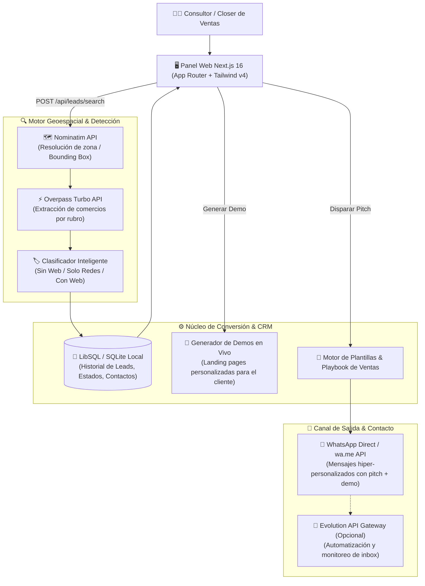

# 🎯 LeadFinder Local — Automated B2B Prospecting & WhatsApp Outreach Engine

[](https://nextjs.org/)
[](https://react.dev/)
[](https://www.typescriptlang.org/)
[](https://tailwindcss.com/)
[](https://sqlite.org/)
[](https://www.openstreetmap.org/)
[](https://www.docker.com/)

**LeadFinder Local** es un motor SaaS integral diseñado para agencias y profesionales digitales orientado a la prospección, auditoría y conversión en frío de negocios locales sin presencia web digital. Integra scraping geoespacial en tiempo real vía **OpenStreetMap (Overpass + Nominatim)**, un pipeline CRM con métricas, un **generador dinámico de páginas demo en vivo** para mostrar a los prospectos, y un sistema de plantillas y contacto directo automatizado para WhatsApp.

---

## 🏛️ Flujo Arquitectónico



---

## 🌟 Capacidades Destacadas

### 1. 🔍 Prospección Geoespacial Automatizada (Sin APIs de Pago)
- Busca comercios por **Zona + Rubro** (Peluquerías, Gomerías, Ferreterías, Restaurantes, Farmacias, etc.) utilizando nodos y polígonos de OpenStreetMap sin costo de Google Maps API.
- Bounding-box inteligente y resolución de coordenadas mediante Nominatim.

### 2. 🏷️ Clasificación Automática de Madurez Digital
- Detecta si el negocio:
  - ❌ **No tiene web:** Prospecto de alta prioridad para venta de landing pages.
  - 📱 **Solo redes sociales:** Prospecto para digitalización y tienda e-commerce.
  - ✅ **Tiene presencia web completa:** Descartado o marcado como baja prioridad.

### 3. 🎨 Generador de Páginas Demo en Tiempo Real
- Crea instantáneamente una landing page interactiva con el nombre y rubro del negocio prospectado (`/demo/...`).
- El mensaje de WhatsApp incluye un enlace a su demo para que el dueño del comercio vea su potencial web antes de responder.

### 4. 📊 CRM Liviano y Pipeline de Estados
- Seguimiento de estados: `Descubierto` ➔ `Contactado` ➔ `En Negociación` ➔ `Cerrado` ➔ `Descartado`.
- Registro y auditoría de interacciones en el Inbox.

### 5. 🐳 Despliegue Portable con Docker y SQLite Persistente
- Cero dependencias complejas de bases de datos externas: opera con LibSQL / SQLite de baja latencia montado en un volumen Docker persistente.

---

## 🚀 Estructura del Código

```
leadfinder-local/
├── app/
│   ├── api/
│   │   ├── health/           # Healthcheck del servicio
│   │   ├── inbox/            # Registro y sincronización de mensajes
│   │   ├── leads/            # Búsqueda, importación y CRUD de prospectos
│   │   └── whatsapp/         # Emparejamiento y estado de la sesión
│   ├── components/           # Componentes UI de panel y tablas
│   ├── demo/                 # Renderizador de landing pages de demostración
│   └── page.tsx              # Dashboard interactivo principal
│
├── lib/
│   ├── classify.ts           # Algoritmo de clasificación de presencia online
│   ├── db.ts                 # Conector y migraciones SQLite / LibSQL
│   ├── demo-pages.ts         # Generador de layouts comerciales
│   ├── nominatim.ts          # Normalización geográfica
│   ├── osm-search.ts         # Orquestador de consultas Overpass
│   ├── outreach-templates.ts # Scripts y plantillas de persuasión
│   ├── sales-playbook.ts     # Estrategias de objeción y cierre
│   └── whatsapp-provider.ts  # Adaptador de mensajería
│
├── docker-compose.yml        # Configuración para despliegue
├── Dockerfile                # Imagen multi-stage optimizada
└── render.yaml               # Manifiesto de despliegue en la nube
```

---

## 🛠️ Instalación y Uso Rápido

### Opción 1: Con Docker (Recomendado)

```bash
# 1. Clonar el repositorio
git clone https://github.com/mauro8778/leadfinder-local.git
cd leadfinder-local

# 2. Iniciar el contenedor
docker compose up --build -d
```
Ingresa a: `http://localhost:4317`

---

### Opción 2: Desarrollo Local

#### Requisitos
- **Node.js:** >= 20.x LTS

```bash
# 1. Instalar dependencias
npm install

# 2. Configurar variables de entorno
cp .env.example .env

# 3. Iniciar el servidor Next.js
npm run dev
```
La aplicación correrá en `http://127.0.0.1:4317`.

---

## 📡 Endpoints de la API REST

| Método | Endpoint | Descripción | Payload de Ejemplo |
| :--- | :--- | :--- | :--- |
| `GET` | `/api/health` | Estado del servicio y base de datos | — |
| `POST` | `/api/leads/search` | Ejecuta prospección en OpenStreetMap | `{"zona": "Palermo, Buenos Aires", "rubro": "peluqueria"}` |
| `GET` | `/api/leads?sinWebOnly=true` | Obtiene lista filtrada de prospectos y métricas | — |
| `PATCH` | `/api/leads/:id` | Actualiza estado CRM del prospecto | `{"status": "contactado"}` |
| `POST` | `/api/inbox/send` | Dispara o registra mensaje enviado | `{"leadId": "...", "message": "..."}` |

---

## ⚖️ Atribución Legal

Los datos geográficos provienen de © [OpenStreetMap](https://www.openstreetmap.org/copyright) contributors, bajo licencia Open Database License (ODbL).

---

## 📄 Licencia

Este proyecto está bajo la Licencia MIT.
